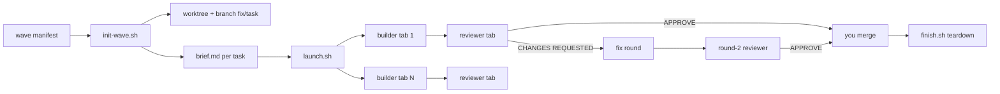

# rex-wave

Fan independent coding tasks out to parallel AI agents in [Rex](https://superlogical.rex) — each with its own git worktree, a visible terminal tab you can watch live, and an automated review pass. One fix round, a second review, then you merge. Nothing ever merges, pushes, or deploys on its own.

Builders: **commandcode**, **Claude Code** (`claude`), **Codex CLI** (`codex`), **opencode** — chosen per wave in the manifest. Reviewers: **opencode**, Claude Code, Codex, or commandcode, same way.

## How it works



1. **Init** — write a manifest (tasks, base branch, model allowlist, test commands). `init-wave.sh` creates one git worktree per task on `fix/<task>`, a run dir, and brief stubs.
2. **Brief** — fill each task brief: goal, owned files, other tasks' files (so parallel work never collides).
3. **Launch** — `launch.sh` opens a visible Rex tab per builder running commandcode with `--yolo` scoped to that worktree.
4. **Review** — a background watcher (`watch.sh`, optionally `--notify` for bell + desktop pings) opens a reviewer tab per finished builder; verdicts land as `VERDICT: APPROVE` or `CHANGES REQUESTED`.
5. **Fix** — paste review findings into a fix brief; `send-fix.sh` delivers it to the idle builder; a round-2 reviewer verifies each finding was fixed.
6. **Merge** — you review and merge. The skill never does.
7. **Teardown** — `finish.sh` removes worktrees and merged branches, closes tabs, deletes the run dir. Refuses anything not yet merged or uncommitted.

## Why

Running several agents on one checkout means merge conflicts, shared test runs, and no isolation. rex-wave gives every agent:

- **its own git worktree** — no cross-contamination, no lock contention
- **file ownership in the brief** — overlapping files are named and forbidden per task
- **a deterministic review gate** — verdicts are parsed from review output, not guessed
- **fail-safe lifecycle** — every script refuses to overwrite, double-launch, or close a working agent; teardown only removes verified-merged work

Run state (briefs, reviews, fix files, verdicts) lives in `~/.local/state/rex-wave/<LABEL>` (XDG-style; override with `REX_WAVE_STATE_DIR`), so a reboot or cleared temp dir does not lose a wave.

## Install

Copy (or symlink) the skill into your skills directory:

```sh
git clone https://github.com/Taimoorkhan1122/rex-wave.git ~/.claude/skills/rex-wave
```

Scripts resolve their own directory, so any install location works. Requires: `sh`, `git`, `jq`, the `rex` CLI (with `REX_SESSION` set), and at least one agent CLI — `commandcode`, `claude`, `codex`, or `opencode` — for builders and reviewers.

## Quick start

```sh
# from inside a Rex terminal tab
echo "$REX_SESSION"                     # must be set

# write a manifest from templates/wave.env.example (run state lives in
# ~/.local/state/rex-wave/<LABEL>, override with REX_WAVE_STATE_DIR), then:
sh scripts/init-wave.sh ~/.local/state/rex-wave/mylabel.env

# fill briefs (Write tool), then per task:
sh scripts/launch.sh ~/.local/state/rex-wave/mylabel T310

# background watcher opens reviewer tabs as builders finish; --notify adds bell + desktop pings:
sh scripts/watch.sh --notify ~/.local/state/rex-wave/mylabel &

# check on everything:
sh scripts/status.sh ~/.local/state/rex-wave/mylabel

# after you merge:
sh scripts/finish.sh ~/.local/state/rex-wave/mylabel --dry-run
sh scripts/finish.sh ~/.local/state/rex-wave/mylabel
```

## Agents and models

The manifest picks the CLI and model per role. `init-wave.sh` validates the agent name and that its CLI is on `PATH`:

| Setting | Values |
|---|---|
| `BUILDER_AGENT` | `commandcode` (default) \| `claude` \| `codex` \| `opencode` |
| `BUILDER_MODEL` | any model id the chosen CLI accepts |
| `REVIEW_AGENT` | `opencode` (default) \| `claude` \| `codex` \| `commandcode` |
| `REVIEW_MODEL` | any model id the chosen CLI accepts |

Profiles for each CLI (interactive builder invocation, non-interactive reviewer invocation, output capture) live in `lib.sh` — `builder_run` and `reviewer_run`. Adding a new agent is one `case` branch in each.

## Safety model

- **No merge, push, PR, or deploy by any agent** — enforced by prompt rules in every brief and by script guards.
- **Per-task file ownership** — briefs list files other tasks own; reviewers flag violations.
- **Allowlisted agents** — the manifest refuses unknown agent names and CLIs not on `PATH`; model ids are whatever the chosen CLI accepts.
- **Fail-safe teardown** — `finish.sh` verifies merge status (`git merge-base --is-ancestor`) and clean worktrees before removing anything; one blocked task aborts everything.
- **Nothing destructive runs unasked** — `close-idle.sh` and `finish.sh` both have `--dry-run`.

## Testing

```sh
sh scripts/selfcheck.sh   # 24 asserts on the state machine; no rex needed
sh e2e/run.sh             # 44 behavioral asserts: stub agents + hermetic fake rex, no network
```

Every claim in this README and SKILL.md is mapped to the test that backs it in [docs/CLAIMS.md](docs/CLAIMS.md).

## License

[MIT](LICENSE)
